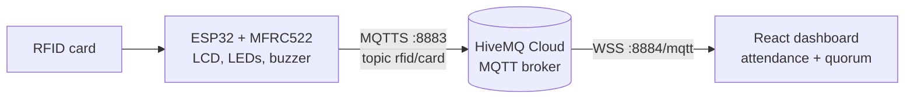

# AMS-ESP32: RFID Assembly Attendance System

Members tap an RFID card on an ESP32 reader. The scan goes through an MQTT broker to a React dashboard, which shows live attendance and whether the meeting has reached quorum.

## What it does

- **ESP32 reader** (`esp32/esp32rfid.ino`) reads MFRC522 RFID cards and shows the member's name and role on a 16x2 I2C LCD
- Gives feedback on each scan: a double buzzer beep, a green LED for a known card, a red LED for an unknown one
- Ignores repeat scans of the same card within 3 seconds
- Publishes each scan as JSON to the MQTT topic `rfid/card` over TLS (port 8883)
- **Web dashboard** (`src/App.tsx`) subscribes over MQTT-over-WebSockets and updates live, with no page refresh:
  - stat cards: registered members, present today, quorum percentage (quorum = at least 50% of members present)
  - attendance table (name, role, RFID tag, time in, status) and a "Recent check-ins" panel
  - MQTT connection status indicator and a Reset button that clears the session

## How it works



Message published by the ESP32:

```json
{ "cardUID": "A1B2C3D4", "deviceId": "ESP32_RFID_Reader", "timestamp": 123456 }
```

The list of known cards (UID, name, role) is hard-coded in two places that must stay in sync: `KNOWN_RFID_CARDS` in `src/App.tsx` and `knownCards` in `esp32/esp32rfid.ino`. Attendance is held in browser memory only. There is no database, so reloading the page starts a new session.

## Tech stack

- **Firmware:** ESP32 (Arduino framework) with `MFRC522v2`, `PubSubClient`, `ArduinoJson`, `LiquidCrystal_I2C`, `WiFiClientSecure`
- **Messaging:** MQTT (HiveMQ Cloud), TLS on the device, WebSockets in the browser
- **Dashboard:** React 18, TypeScript, Vite 4, `mqtt.js`, `lucide-react` icons
- **Hosting:** static build configured for Vercel (`vercel.json`)

## Hardware wiring (from the sketch)

| Component | ESP32 pin |
| --- | --- |
| MFRC522 SS (SDA) | GPIO 5 |
| MFRC522 RST | GPIO 2 |
| MFRC522 SCK / MISO / MOSI | default SPI pins (GPIO 18 / 19 / 23) |
| LCD 16x2 I2C (addr `0x27`) SDA / SCL | GPIO 21 / GPIO 22 |
| Success LED | GPIO 17 |
| Error LED | GPIO 16 |
| Buzzer | GPIO 4 |

## Getting started

### 1. Firmware

1. Install the ESP32 board package in the Arduino IDE, plus the libraries listed above.
2. In `esp32/esp32rfid.ino`, set your Wi-Fi SSID and password, MQTT host, username and password.
3. Add your card UIDs to `knownCards` (the UIDs are printed on the Serial monitor at 115200 baud).
4. Upload to the ESP32. The LCD shows `READY: Scan RFID card` once it is connected.

### 2. Dashboard

```bash
npm install
npm run dev        # start the Vite dev server
npm run build      # type-check (tsc) and build to dist/
npm run preview    # serve the production build locally
```

Set the broker WebSocket URL and credentials in the `mqtt.connect(...)` call in `src/App.tsx`, and add the same card UIDs to `KNOWN_RFID_CARDS`.

## Project structure

```
esp32/esp32rfid.ino     ESP32 firmware: RFID, LCD, LEDs, buzzer, MQTT publish
src/App.tsx             MQTT subscription, attendance state, quorum logic
src/components/         Stats, AttendanceList, RecentActivity (+ CSS)
src/types/Attendee.ts   Shared TypeScript types
src/mqtt/mqttClient.tsx Early Node-style MQTT test client (not used by the app)
src/services/api.ts     REST client draft (not used by the app)
vercel.json             Vercel static-build config
```

## Context

Built for the *Réseaux d'Entreprises / Réseaux Hétérogènes* course project (2025) at ENISo, Tunisia, by Mohamed Amine Ben Mosbah.

## Possible improvements

- Move Wi-Fi and broker credentials out of the source (`.env` with `VITE_` variables for the dashboard, a `secrets.h` ignored by git for the firmware)
- Load the member list from a single source instead of duplicating it
- Store check-ins in a database so attendance survives a page reload
